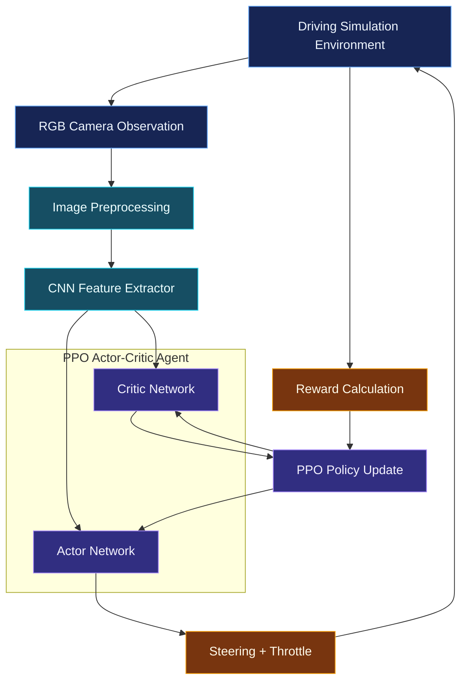
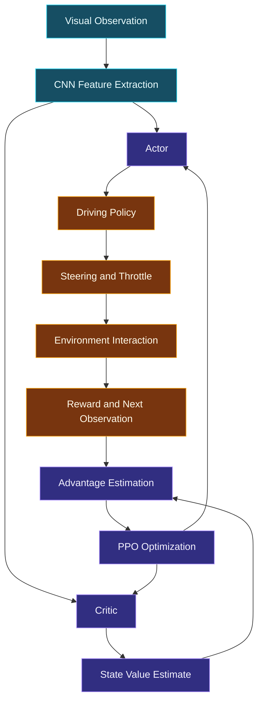
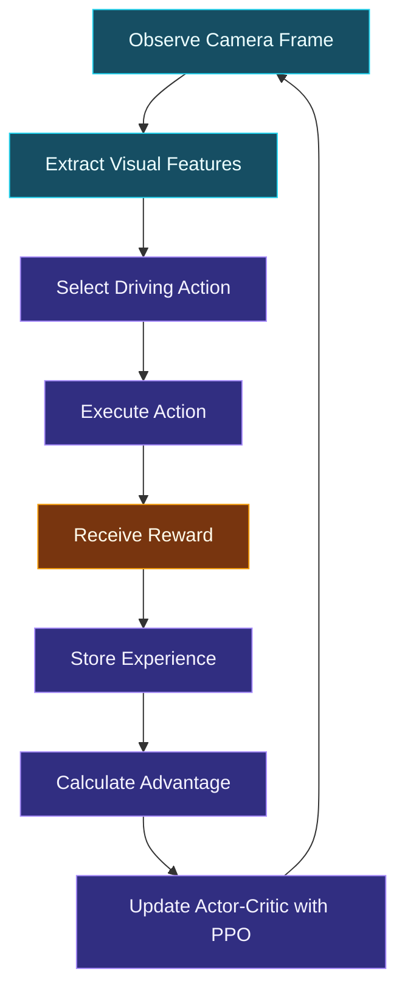
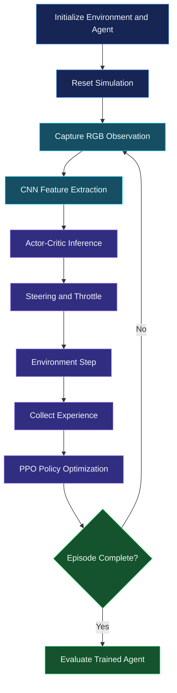

# 🚗 Autonomous Navigation Using Deep Reinforcement Learning
### Vision-Based Driving with CNN + PPO Actor-Critic

<p align="center">
  
</p>

<p align="center">
  
  
  
  
  
</p>

<p align="center">
  <b>An autonomous driving agent that learns steering and throttle control directly from RGB camera observations using a CNN-based Proximal Policy Optimization (PPO) Actor-Critic architecture.</b>
</p>

<p align="center">
  <a href="#-overview">Overview</a> •
  <a href="#-architecture">Architecture</a> •
  <a href="#-learning-agent">Learning Agent</a> •
  <a href="#-training">Training</a> •
  <a href="#-results">Results</a> •
  <a href="#-setup">Setup</a>
</p>

---

## `~/overview` — Project Introduction

Autonomous driving requires an intelligent system to perceive its surroundings, understand the current driving situation, and make continuous control decisions.

Traditional approaches often depend on manually designed rules and predefined driving strategies. This project explores a different approach: allowing an agent to learn driving behavior through interaction with a simulated environment.

The system uses **Deep Reinforcement Learning (DRL)** to train an autonomous driving agent that processes raw RGB camera observations and learns to control steering and throttle.

A CNN extracts visual features from camera frames, while a PPO-based Actor-Critic architecture learns a policy for selecting driving actions.

### Project Highlights

| Component | Implementation |
|---|---|
| Learning approach | Deep Reinforcement Learning |
| Algorithm | Proximal Policy Optimization (PPO) |
| Policy architecture | Actor-Critic |
| Visual perception | Convolutional Neural Network |
| Input | Raw RGB camera observations |
| Control outputs | Steering and throttle |
| Reward objectives | Lane-centering, speed regulation, collision avoidance |
| Evaluation | Multiple track configurations |
| Generalization | Mountain-track scenario evaluation |
| Framework | Python, PyTorch |

### Key Objective

Develop an autonomous driving agent capable of learning navigation behavior from visual observations rather than relying entirely on manually programmed driving rules.

---

## `~/architecture` — System Architecture

The project follows a perception-to-action learning pipeline.



### Component Responsibilities

| Component | Responsibility |
|---|---|
| Simulation environment | Provides driving scenarios and vehicle interaction |
| RGB camera | Captures visual observations |
| Preprocessing | Prepares camera frames for neural network input |
| CNN | Extracts useful visual representations |
| Actor | Learns the driving policy |
| Critic | Estimates the value of the current state |
| PPO | Updates the policy using collected experience |
| Reward function | Encourages desirable driving behavior |

---

## `~/visual_perception` — Learning from Camera Images

Instead of relying only on manually supplied driving instructions, the agent receives visual information from its camera.

The CNN acts as the perception component of the learning system.

### Visual Perception Pipeline


The CNN learns visual representations that help the policy make driving decisions.

These representations can help the agent learn patterns associated with:

- Road and lane positioning.
- Visual driving conditions.
- Track geometry.
- Navigation-relevant scene information.

*The exact CNN layer configuration and image dimensions should be documented from the implemented model.*

---

## `~/learning_agent` — PPO Actor-Critic

The learning agent uses **Proximal Policy Optimization (PPO)**, a policy-gradient reinforcement learning algorithm.

PPO is designed to improve policy learning while restricting excessively large policy updates.

### Actor Network

The Actor learns the driving policy.

It uses the visual representation to determine the control action, including steering and throttle.

### Critic Network

The Critic estimates how valuable the current state is under the learned policy.

Its value estimation helps calculate the advantage used during policy optimization.

### Actor-Critic Relationship



### Why PPO?

- Uses policy-gradient learning.
- Employs a clipped objective to limit excessively large policy updates.
- Uses an Actor-Critic structure.
- Supports learning continuous control policies.
- Can learn through repeated interaction with a simulation environment.

---

## `~/control_system` — Steering and Throttle

The agent learns to control vehicle movement through its policy.

| Control | Purpose |
|---|---|
| Steering | Controls the vehicle's turning direction |
| Throttle | Controls vehicle acceleration |

The objective is not simply to move forward. The agent must learn how its actions affect the vehicle's position and driving behavior over time.

The learned policy is evaluated across different track configurations.

---

## `~/reward_design` — Driving Objectives

Reinforcement learning depends on a reward signal that guides the agent toward desirable behavior.

This project incorporates reward objectives associated with:

| Objective | Learning purpose |
|---|---|
| Lane-centering | Encourage maintaining a suitable lane position |
| Speed regulation | Encourage appropriate vehicle speed |
| Collision avoidance | Discourage unsafe interactions |
| Navigation progress | Encourage forward movement through the track |

### Learning Loop



The reward function influences what the agent learns. Its exact numerical weights and termination conditions should be taken from the training implementation.

---

## `~/training` — Training and Evaluation

The agent learns by repeatedly interacting with the driving simulation.

### Training Workflow

1. Initialize the simulation environment.
2. Capture an RGB camera observation.
3. Process the observation through the CNN.
4. Generate driving actions using the Actor.
5. Estimate state value using the Critic.
6. Execute the selected control actions.
7. Collect reward and subsequent observations.
8. Use collected experience for PPO optimization.
9. Evaluate the learned policy on different track configurations.

### Training Pipeline



### Evaluation Scenarios

The agent was trained and evaluated across multiple track configurations.

The project specifically explored:

- Learning lane-following behavior.
- Regulating vehicle speed.
- Avoiding collisions.
- Testing navigation on different track layouts.
- Evaluating generalization to a mountain-track scenario.

---

## `~/results` — Observed Outcomes

The project demonstrated:

- End-to-end visual control using RGB camera input.
- CNN-based feature extraction for driving decisions.
- PPO Actor-Critic policy learning.
- Steering and throttle control through reinforcement learning.
- Full-lap navigation in simulation.
- Generalization to a mountain-track scenario.

### Outcome Summary

| Evaluation Area | Reported Outcome |
|---|---|
| Visual input | Raw RGB camera observations |
| Learning algorithm | CNN-based PPO Actor-Critic |
| Vehicle controls | Steering and throttle |
| Lane behavior | Lane-centering reward objective |
| Safety behavior | Collision-avoidance reward objective |
| Navigation | Full-lap navigation achieved |
| Generalization | Mountain-track scenario |

*Quantitative success rates, collision counts, lap times, and training curves are not included here because verified numerical measurements were not available in the project summary.*

---

## `~/technology` — Technology Stack

<p align="center">
  
</p>

| Category | Technology |
|---|---|
| Programming Language | Python |
| Deep Learning | PyTorch |
| Computer Vision | CNN |
| Reinforcement Learning | Proximal Policy Optimization |
| Neural Architecture | Actor-Critic |
| Input Modality | RGB Camera Images |
| Control | Steering and Throttle |
| Development | Git, GitHub |

---

## `~/engineering_decisions` — Design Rationale

| Design Choice | Reason |
|---|---|
| CNN-based perception | Extract visual features from camera images |
| PPO | Learn a policy through stable, constrained policy updates |
| Actor-Critic | Separate policy generation and value estimation |
| RGB observations | Learn directly from visual information |
| Reward-based training | Encourage lane-centering, speed regulation, and collision avoidance |
| Multiple track configurations | Evaluate behavior beyond a single track |

---

## `~/setup` — Getting Started

The exact simulation framework, folder structure, dependency versions, and training scripts should be matched to the repository before publishing executable setup instructions.

### Prerequisites

- Python
- PyTorch
- Required simulation environment
- Git

### 01 / Clone the Repository

```bash
git clone <YOUR_REPOSITORY_URL>
cd <YOUR_REPOSITORY_DIRECTORY>
```

### 02 / Create a Virtual Environment

```bash
python -m venv venv
```

Windows:

```bash
venv\Scripts\activate
```

Linux / macOS:

```bash
source venv/bin/activate
```

### 03 / Install Dependencies

If the repository contains a `requirements.txt` file:

```bash
pip install -r requirements.txt
```

Install the appropriate PyTorch version for your hardware and Python environment if it is not included in the dependency file.

### 04 / Train the Agent

Run the actual training entry-point script from the repository:

```bash
python <TRAINING_SCRIPT>.py
```

### 05 / Evaluate the Agent

Run the implemented evaluation or inference script:

```bash
python <EVALUATION_SCRIPT>.py
```

> The commands above are templates. Replace the placeholders with the actual script names and simulation setup instructions from the repository.

---

## `~/roadmap` — Future Improvements

Potential future directions:

- [ ] Add quantitative evaluation metrics and training curves.
- [ ] Compare PPO against alternative reinforcement learning algorithms.
- [ ] Evaluate robustness under different lighting and visual conditions.
- [ ] Introduce domain randomization.
- [ ] Investigate sim-to-real transfer.
- [ ] Add detailed experiment tracking.
- [ ] Evaluate generalization across a larger set of unseen tracks.
- [ ] Investigate explainability of visual driving decisions.

*These are proposed enhancements, not claims about existing functionality.*

---

## `~/engineering_learnings` — What This Project Explores

This project brings together several important areas of intelligent systems engineering:

**Deep Learning**
- CNN-based visual feature extraction.
- Neural network representation learning.
- Actor-Critic network design.

**Reinforcement Learning**
- Policy-gradient methods.
- PPO optimization.
- Reward design.
- Learning through environment interaction.

**Autonomous Systems**
- Visual perception.
- Continuous vehicle control.
- Navigation under changing track conditions.
- Evaluation of learned behavior.

---

## `~/author` — Project Information

**Developer:** Sarthak Tanpure  
**Institution:** Pravara Rural Engineering College  
**Degree:** B.E. Information Technology  
**Project Domain:** Deep Reinforcement Learning · Computer Vision · Autonomous Systems

<p align="center">
  <a href="https://github.com/Sarthaktanpure">
    
  </a>
  <a href="https://www.linkedin.com/in/sarthak-tanpure-a74b5133a/">
    
  </a>
</p>

<p align="center">
  <b>From pixels to policies — teaching an agent to learn how to drive.</b>
</p>

<p align="center">
  
</p>